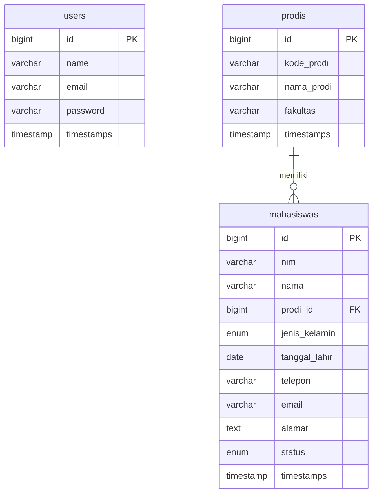

<div align="center">

# 🎓 SIM Mahasiswa (Sistem Informasi Manajemen Mahasiswa)


<p align="center">
  <b>Aplikasi Manajemen Data Mahasiswa & Program Studi modern dengan sentuhan estetika Crimson Luxury & Adaptive Dark Mode.</b>
</p>

</div>

---

## ✨ Fitur Unggulan

- 💎 **Modern Crimson Aesthetics**: Antarmuka elegan dengan kombinasi warna gradasi merah *crimson* mewah.
- 🌙 **Adaptive Dark / Light Mode**: Fitur ganti tema otomatis (menyimpan preferensi via `localStorage`) dengan konsep unik *Sidebar Putih Bersih* saat mode gelap aktif.
- 📊 **Manajemen Mahasiswa Komprehensif**: Fitur CRUD lengkap dengan status keaktifan interaktif (*Toggle Switch* Aktif/Tidak Aktif) dan keterangan status *real-time*.
- 🏢 **Manajemen Program Studi**: Pengelolaan data program studi dan fakultas yang terintegrasi secara relasional.
- 🔍 **Advanced Search & Filter**: Pencarian data cepat berdasarkan NIM/Nama serta filter berdasarkan Program Studi.
- 📄 **Export PDF**: Fitur cetak laporan data mahasiswa ke format PDF secara instan menggunakan integrasi DomPDF.

---

## 🛠️ Tech Stack

* **Framework Backend:** Laravel 10/11 (PHP)
* **Frontend UI:** Bootstrap 5.3, Bootstrap Icons, Google Fonts (Plus Jakarta Sans)
* **Database:** MySQL
* **Library Pendukung:** `barryvdh/laravel-dompdf`

---

## 🚀 Panduan Instalasi & Menjalankan Proyek

Ikuti langkah-langkah di bawah ini untuk menjalankan proyek ini di komputer lokal Anda:

1. **Clone Repository**
   ```bash
   https://github.com/dm1893221-glitch/Framework-SIM-Mahasiswa
   cd sim-mahasiswa

   <div align="center">

---

## 📁 Struktur Aplikasi (Directory Structure)

Berikut adalah ringkasan struktur direktori utama dari proyek ini:

```text
sim-mahasiswa/
├── app/
│   ├── Http/
│   │   └── Controllers/
│   │       ├── MahasiswaController.php  # Mengelola logika CRUD & cetak PDF Mahasiswa
│   │       └── ProdiController.php      # Mengelola data Program Studi
│   └── Models/
│       ├── Mahasiswa.php                # Model relasi Mahasiswa ke Prodi
│       └── Prodi.php                    # Model relasi Prodi
├── database/
│   ├── migrations/                      # Skema tabel database
│   └── seeders/                         # Data dummy awal aplikasi
├── resources/
│   └── views/
│       ├── layouts/
│       │   └── app.blade.php            # Layout utama, Sidebar, Topbar, & Dark Mode
│       ├── mahasiswa/                   # Views (index, create, edit, show, pdf)
│       └── prodi/                       # Views Program Studi
└── routes/
    └── web.php                          # Konfigurasi rute aplikasi web
```

## 🗄️ Struktur Database (Database Schema & Relasi)

Berikut adalah diagram relasi dan struktur tabel database dalam aplikasi ini:


---

## 🛣️ Alur Rute & Navigasi (Key Routes)

| Method | URI | Controller Action | Keterangan |
| :--- | :--- | :--- | :--- |
| `GET` | `/mahasiswa` | `MahasiswaController@index` | Menampilkan daftar mahasiswa + Filter/Search |
| `GET` | `/mahasiswa/create` | `MahasiswaController@create` | Form tambah data mahasiswa |
| `POST` | `/mahasiswa` | `MahasiswaController@store` | Menyimpan data mahasiswa baru |
| `GET` | `/mahasiswa/{id}` | `MahasiswaController@show` | Detail informasi mahasiswa & badge status |
| `GET` | `/mahasiswa/{id}/edit` | `MahasiswaController@edit` | Form edit data mahasiswa |
| `PUT` | `/mahasiswa/{id}` | `MahasiswaController@update` | Memperbarui data mahasiswa |
| `DELETE` | `/mahasiswa/{id}` | `MahasiswaController@destroy` | Menghapus data mahasiswa |
| `GET` | `/mahasiswa/pdf` | `MahasiswaController@pdf` | Cetak/Stream dokumen laporan PDF |

---

## 🛡️ Keamanan & Optimasi

- **CSRF Protection**: Seluruh form input dilindungi dengan token `@csrf` bawaan Laravel.
- **SQL Injection Prevention**: Menggunakan Eloquent ORM & Prepared Statements untuk mencegah eksekusi query berbahaya.
- **Form Input Validation**: Validasi ketat di sisi server menggunakan `FormRequest` / `Validator` (seperti keunikan NIM, opsi enum jenis kelamin, dan format email).
- **Responsive Breakpoints**: Layout telah diuji dan responsif di berbagai resolusi layar (Desktop, Tablet, Mobile).

---

## 📌 Rencana Pengembangan (Roadmap)

- [x] CRUD Mahasiswa & Program Studi
- [x] Adaptive Dark Mode dengan CSS Variables & LocalStorage
- [x] Dynamic Status Switch (Aktif / Tidak Aktif)
- [x] Export Laporan PDF (DomPDF)
- [ ] Export Data ke Excel / CSV
- [ ] Multi-Role Authentication (Admin, Dosen, Mahasiswa)
- [ ] Import Massal Data Mahasiswa via Excel
